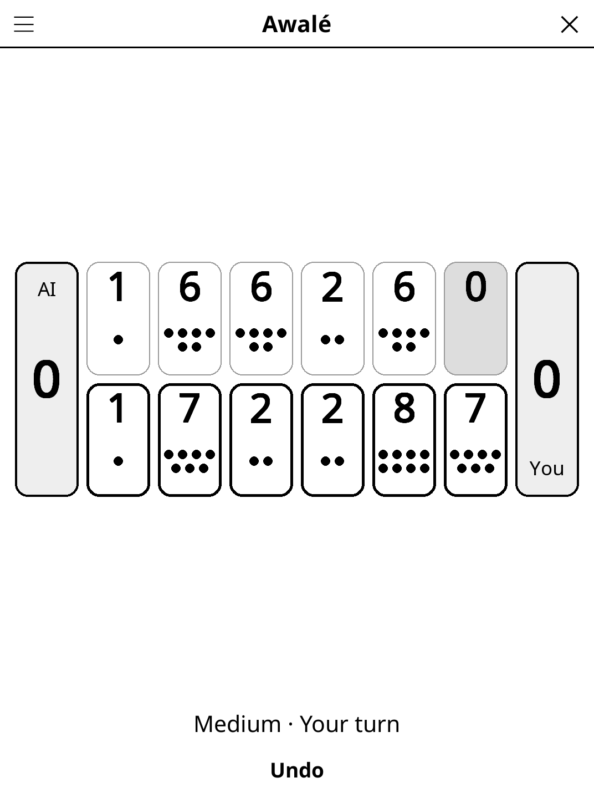

# awale.koplugin

Awalé (Oware, abapa rules) for [KOReader](https://github.com/koreader/koreader):
sow seeds around a 2×6 board and capture 2s and 3s, against the AI or a friend
on the same device.

## Screenshot

## Rules

Each player owns the row of six pits nearest to them; every pit starts with 4
seeds. On your turn, tap one of your pits: its seeds are sown one by one,
counter-clockwise, into the following pits (a pit of 12 or more laps the board
and skips the pit it came from). If the last seed lands in an opponent pit that
now holds 2 or 3, you capture it, along with the opponent pits just before it
that also hold 2 or 3.

- **Grand slam** — a move that would capture every opponent seed is allowed but
  captures nothing.
- **Feeding** — if your opponent has no seeds you must give them some; if no
  move can, the game ends and you keep the seeds left on your side.
- **Winning** — first to 25 seeds; 24–24 is a draw.
- **Endless cycles** — a position seen for the third time, or 100 moves with
  no capture, ends the game and each player keeps the seeds on their side.

## Features

- **1 player vs AI** (easy / medium / hard) or **2 players** on one device
- **Play as South or North** against the AI (South moves first)
- **Clear counts** — every pit shows its seed count in large digits, plus dots
  up to 16 seeds; the pits you may play are framed in bold
- **Undo** — against the AI, takes back the AI's reply and your move
- **Auto-save** — the game, with its undo history, is restored on next launch

## The AI

Negamax with alpha-beta pruning and iterative deepening on a think-time
budget, scoring the store difference. Easy searches 2 plies with a large
random margin, medium up to 6 plies with a small one, hard as deep as 1 s of
CPU time allows (typically 12+ plies here). The budget is CPU time, so a slower
e-reader searches less deep rather than waiting longer.

## Installation

1. Download `awale.koplugin.zip` from the [latest release](../../releases/latest).
2. Extract into the `plugins/` folder of your KOReader data directory.
3. Restart KOReader.
4. Open the menu → **Tools** → **Awalé**.

## Controls

| Action | How |
|--------|-----|
| Sow a pit | Tap one of your bold-framed pits |
| Take back a move | Tap **Undo** |
| New game, difficulty, players, side, rules | Title-bar menu |

## License

GPL-3.0 — see [LICENSE](LICENSE).
